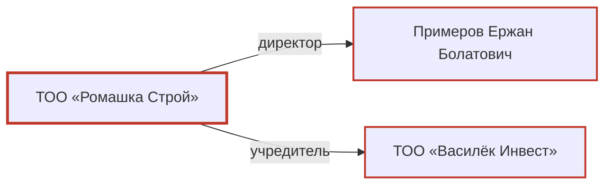

> **Демо-отчёт.** Все компании, люди, идентификаторы, публикации и сайты вымышлены. Сгенерирован командой `python cli.py demo` без API-ключа и сети: ответы агента, страницы и реестры проигрываются из `demo/scenario.json`, остальное делает настоящий пайплайн.

# Проверка контрагента: ТОО «Ромашка Строй»

| | |
|---|---|
| Тип | Юрлицо |
| БИН/ИИН | 123456789012 |
| Цель проверки | ДЕМО: вымышленные данные. Проверка поставщика перед заключением договора |
| Дата | 2026-09-30 07:08 UTC |
| ID проверки | 4d57baacc61e |

## Итог: риск **высокий** (0.91)

| Категория | Фактов |
|---|---|
| Госзакупки (РНУ) | 1 |
| Отмывание / обнал | 1 |
| Трудовые нарушения | 1 |
| Мошенничество | 1 |

Негатив по связанным лицам и компаниям: 2 факта, учитывается в оценке с пониженным весом.

## Факты о субъекте

### 1. Госзакупки (РНУ): Компания включена в реестр недобросовестных участников госзакупок
- Статус: **в реестре**, тяжесть: high, риск факта: 0.75
- Подтверждено: 1 независимым источником; сила доказательств 1.00, вес давности 1.00
- Идентификация: запись найдена по БИН/ИИН
- Источники:
  - [РНУ (демо)](https://registry.example/rnu/123456789012), 2025-11-03, реестр, официальный реестр, идентификация 100%, id `7f993b0bb6a0`
    > включена в РНУ на 24 месяца по иску ГУ «Отдел строительства»; решение суда 2-1187/2025

### 2. Отмывание / обнал: Компанию подозревают в обналичивании 1,2 млрд тенге через фирмы-однодневки
- Статус: **расследование**, тяжесть: high, риск факта: 0.45
- Подтверждено: 2 независимыми источниками; сила доказательств 0.99, вес давности 1.00
- Идентификация: сходство названия 100%; БИН/ИИН субъекта есть в тексте источника; совпадает город; упомянуты связанные лица/компании: 1
- Источники:
  - [KZ Daily (демо)](https://kz-daily.example/2026/05/romashka-obnal), 2026-05-12, крупное СМИ, цитата подтверждена, идентификация 100%, id `85004afdd4d2`
    > Алматинское ТОО «Ромашка Строй» (БИН 123456789012) подозревают в обналичивании 1,2 млрд тенге через фирмы-однодневки.
  - [Business KZ (демо)](https://business-kz.example/news/48213), 2026-05-13, крупное СМИ, цитата подтверждена, идентификация 100%, id `8347cc45059f`
    > по версии следствия, компания обналичивала деньги через фирмы-однодневки

### 3. Трудовые нарушения: Рабочие жаловались на задержку зарплаты за три месяца
- Статус: **публикации**, тяжесть: medium, риск факта: 0.07
- Подтверждено: 1 независимым источником; сила доказательств 0.63, вес давности 0.66
- Идентификация: сходство названия 100%; совпадает город
- Источники:
  - [Old News (демо)](https://old-news.example/2021/zarplata), 2021-09-14, СМИ, цитата подтверждена по архивной копии, [архив](https://web.archive.org/web/20210914083000id_/https://old-news.example/2021/zarplata), идентификация 100%, id `9d3efb1ed0aa`
    > Рабочие алматинского ТОО «Ромашка Строй» пожаловались на задержку зарплаты за три месяца.

### 4. Мошенничество: Утверждается, что компания обманула 300 дольщиков
- Статус: **публикации**, тяжесть: high, риск факта: 0.01
- Подтверждено: нет подтверждённых источников; сила доказательств 0.06, вес давности 0.80
- Идентификация: сходство названия 100%
- Источники:
  - [Anon Blog (демо)](https://anon-blog.example/post/77), соцсети / форум, ⚠ цитата не найдена на странице, идентификация 100%, id `91ace4edee85`
    > ТОО «Ромашка Строй» обманула 300 дольщиков

## Негатив по связанным лицам и компаниям

### 1. Налоги: Директор осуждён за уклонение от уплаты налогов
- Касается: **Примеров Ержан Болатович** (Субъект → директор: Примеров Ержан Болатович)
- Статус: **приговор**, тяжесть: high, риск факта: 0.19
- Подтверждено: 1 независимым источником; сила доказательств 1.00, вес давности 0.50
- Идентификация: совпадают фамилия, имя и отчество
- Источники:
  - [Архив судебных актов (демо)](https://court-archive.example/cases/1-512-2019), 2019-11-05, госисточник, цитата подтверждена, идентификация 100%, id `55b904600e3f`
    > Примеров Ержан Болатович признан виновным в уклонении от уплаты налогов

### 2. Регуляторы: Учредителя оштрафовали за сговор на торгах
- Касается: **ТОО «Василёк Инвест»** (Субъект → учредитель: ТОО «Василёк Инвест»)
- Статус: **решение суда**, тяжесть: medium, риск факта: 0.16
- Подтверждено: 1 независимым источником; сила доказательств 0.90, вес давности 1.00
- Идентификация: сходство названия 100%
- Источники:
  - [Business KZ (демо)](https://business-kz.example/news/50110), 2024-03-02, крупное СМИ, цитата подтверждена, идентификация 100%, id `34b790bc945f`
    > Антимонопольное агентство оштрафовало ТОО «Василёк Инвест» за сговор на торгах

## Граф связей

Красным отмечены сущности с негативными фактами.

## Возможные однофамильцы / тёзки (требуют ручной проверки)

Эти находки негативные, но связь с субъектом не подтверждена. В оценку риска они не входят.

### 1. Банкротство: Компания признана банкротом по иску поставщика цемента
- Статус: **решение суда**, тяжесть: high
- Идентификация: 10% (сходство названия 100%; рядом с именем другой БИН/ИИН; в источнике другой город)
- В источнике: «ТОО «Ромашка Строй»»
  - [South News (демо)](https://south-news.example/2025/bankrot), 2025-08-20, СМИ, цитата подтверждена, идентификация 10%, id `642667b5106a`
    > признано банкротом по иску поставщика цемента

## Проверенные источники

| Источник | Статус | Совпадений | Примечание |
|---|---|---|---|
| Реестр недобросовестных участников госзакупок (демо) | ok | 1 |  |
| Санкционные списки (демо-выгрузка) | ok | 0 | совпадений нет |
| Глубокий веб-поиск (Claude web search) | ok | 7 |  |

Раундов глубокого поиска: 2, поисковых запросов: 6, время проверки: 6 с.

Поисковые запросы

- "Ромашка Строй" Алматы уголовное дело
- ТОО Ромашка Строй обналичивание однодневки
- "Ромашка Строй" банкротство OR долг OR зарплата
- Romashka Stroy LLP fraud
- "Примеров Ержан Болатович" приговор
- "Василёк Инвест" штраф OR суд OR РНУ

## Ограничения

- Отчёт собран автоматически из открытых источников и требует проверки аналитиком.
- Статус «публикации» и «расследование» означает подозрение, а не установленную вину.
- Вес источника: реестр и госисточник 1.0, крупное СМИ 0.9, прочие СМИ 0.7, соцсети и форумы 0.4; старые публикации весят меньше (полураспад 5 лет).
- Страницы за пейволлом, капчей или удалённые без архивной копии не проверялись; судебные акты РК обезличены, поэтому связь с субъектом часто устанавливается только косвенно.
